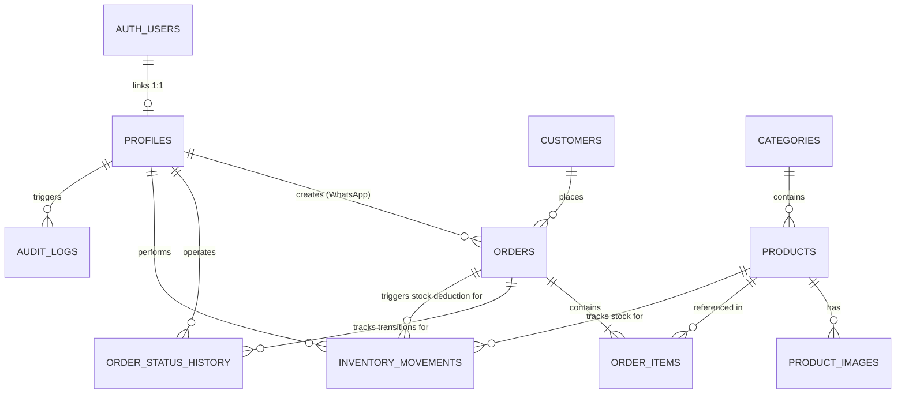
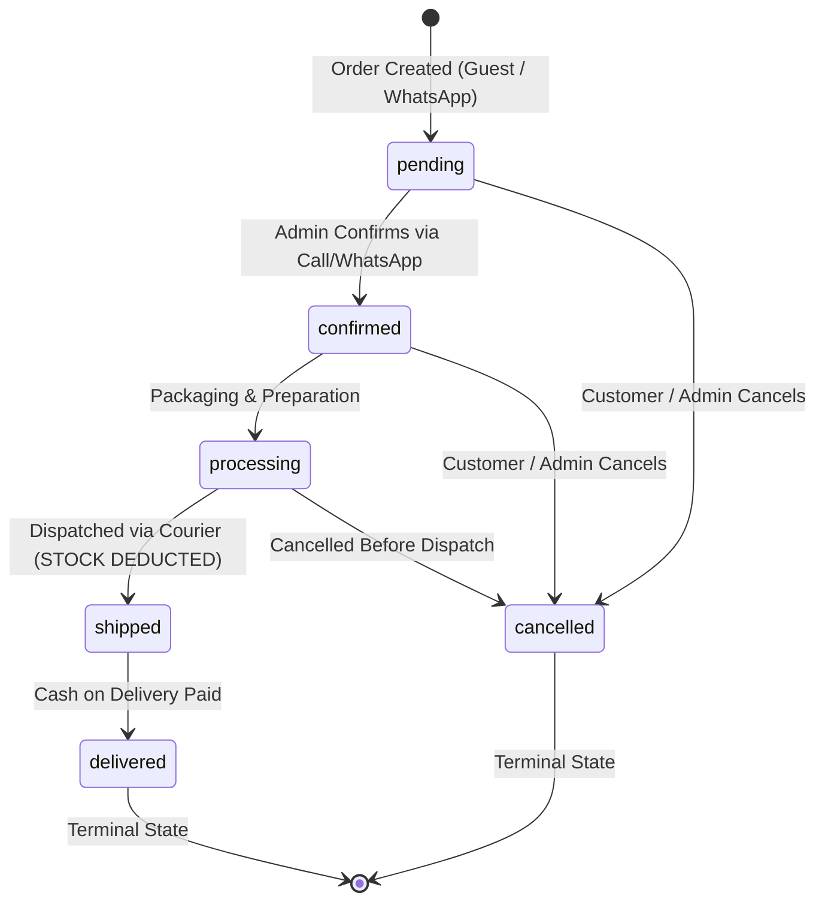

# Aroma Rose — Database Architecture & Schema Specification

**Document Version:** 1.0.0
**Target Engine:** Supabase PostgreSQL 15+ / PostgreSQL 16
**Architecture Classification:** High-Integrity E-Commerce Ledger

---

## 1. System Overview

Aroma Rose is a luxury e-commerce platform offering premium Moroccan rose-derived products (inspired by Kelaat M'Gouna). The database foundation is designed to enforce strict transactional integrity, prevent stock overdrafts under heavy concurrency, maintain tamper-proof historical order records, and enforce zero-trust Row Level Security (RLS).

---

## 2. Entity-Relationship Diagram (ERD)



---

## 3. Data Dictionary: The 10 Core Entities

### 3.1. `profiles`
Links administrative and staff accounts to Supabase Auth (`auth.users`).
- `id` (`UUID PRIMARY KEY`): Foreign key to `auth.users(id) ON DELETE CASCADE`.
- `full_name` (`TEXT NOT NULL`): Staff member's name.
- `role` (`user_role NOT NULL DEFAULT 'staff'`): `'admin'` or `'staff'`.
- `is_active` (`BOOLEAN NOT NULL DEFAULT true`): Administrative kill-switch for deactivated staff.
- `created_at` / `updated_at` (`TIMESTAMPTZ NOT NULL DEFAULT now()`).

### 3.2. `customers`
Stores customer records for Guest Checkout orders.
- `id` (`UUID PRIMARY KEY DEFAULT gen_random_uuid()`).
- `first_name` (`TEXT NOT NULL`), `last_name` (`TEXT NOT NULL`).
- `phone` (`TEXT NOT NULL`): Primary contact for Moroccan delivery confirmation.
- `email` (`TEXT NULL`): Optional email for delivery notices.
- `city` (`TEXT NOT NULL`), `address` (`TEXT NOT NULL`), `postal_code` (`TEXT NULL`).
- `notes` (`TEXT NULL`): Delivery directions or landmark notes.
- `created_at` / `updated_at` (`TIMESTAMPTZ NOT NULL DEFAULT now()`).

### 3.3. `categories`
Organizes catalog products (e.g., Floral Waters, Essential Oils, Skincare).
- `id` (`UUID PRIMARY KEY DEFAULT gen_random_uuid()`).
- `name` (`TEXT NOT NULL`), `slug` (`TEXT NOT NULL UNIQUE`).
- `description` (`TEXT NULL`).
- `is_active` (`BOOLEAN NOT NULL DEFAULT true`): Governs public visibility.
- `display_order` (`INT NOT NULL DEFAULT 0`): Ordering in storefront navigation.
- `created_at` / `updated_at` (`TIMESTAMPTZ NOT NULL DEFAULT now()`).

### 3.4. `products`
The core catalog and live stock ledger.
- `id` (`UUID PRIMARY KEY DEFAULT gen_random_uuid()`).
- `category_id` (`UUID NULL REFERENCES categories(id) ON DELETE SET NULL`).
- `name` (`TEXT NOT NULL`), `slug` (`TEXT NOT NULL UNIQUE`), `sku` (`TEXT UNIQUE NULL`).
- `description` (`TEXT NULL`).
- `price` (`NUMERIC(12, 2) NOT NULL CHECK (price >= 0)`): Current retail price in MAD.
- `compare_at_price` (`NUMERIC(12, 2) NULL CHECK (compare_at_price IS NULL OR compare_at_price >= price)`).
- `cost_price` (`NUMERIC(12, 2) NULL CHECK (cost_price IS NULL OR cost_price >= 0)`): Internal cost tracking.
- `stock_quantity` (`INT NOT NULL DEFAULT 0 CHECK (stock_quantity >= 0)`): Live available inventory.
- `is_active` (`BOOLEAN NOT NULL DEFAULT true`).
- `created_at` / `updated_at` (`TIMESTAMPTZ NOT NULL DEFAULT now()`).

### 3.5. `product_images`
Product imagery metadata pointing to Supabase Storage objects.
- `id` (`UUID PRIMARY KEY DEFAULT gen_random_uuid()`).
- `product_id` (`UUID NOT NULL REFERENCES products(id) ON DELETE CASCADE`).
- `storage_path` (`TEXT NOT NULL`): Storage bucket path (e.g., `catalog/rose-water.jpg`).
- `alt_text` (`TEXT NULL`).
- `display_order` (`INT NOT NULL DEFAULT 0`).
- `is_primary` (`BOOLEAN NOT NULL DEFAULT false`).
- *Constraint:* Unique partial index `idx_unique_primary_product_image` ensures only one primary image per product.

### 3.6. `orders`
Centralized repository for all orders (Website Guest Orders + WhatsApp Admin Orders).
- `id` (`UUID PRIMARY KEY DEFAULT gen_random_uuid()`).
- `order_number` (`TEXT NOT NULL UNIQUE`): Format `AR-YYYYMMDD-XXXX`.
- `customer_id` (`UUID NOT NULL REFERENCES customers(id) ON DELETE RESTRICT`).
- `order_source` (`order_source NOT NULL DEFAULT 'website'`): `'website'` or `'whatsapp'`.
- `status` (`order_status NOT NULL DEFAULT 'pending'`): `'pending'`, `'confirmed'`, `'processing'`, `'shipped'`, `'delivered'`, `'cancelled'`.
- `payment_method` (`payment_method NOT NULL DEFAULT 'cod'`): Cash on Delivery.
- `payment_status` (`payment_status NOT NULL DEFAULT 'unpaid'`): `'unpaid'`, `'paid'`, `'refunded'`.
- `subtotal` (`NUMERIC(12, 2) NOT NULL CHECK (subtotal >= 0)`).
- `shipping_fee` (`NUMERIC(12, 2) NOT NULL DEFAULT 0.00 CHECK (shipping_fee >= 0)`).
- `total_amount` (`NUMERIC(12, 2) NOT NULL CHECK (total_amount >= 0)`).
- `shipping_city`, `shipping_address`, `shipping_phone` (`TEXT NOT NULL`).
- `customer_notes` (`TEXT NULL`), `admin_notes` (`TEXT NULL`).
- `created_by_profile_id` (`UUID NULL REFERENCES profiles(id) ON DELETE SET NULL`).
- `shipped_at`, `delivered_at`, `cancelled_at` (`TIMESTAMPTZ NULL`).
- `created_at` / `updated_at` (`TIMESTAMPTZ NOT NULL DEFAULT now()`).
- *Key Constraints:*
  - `chk_order_total_match`: `CHECK (total_amount = subtotal + shipping_fee)`.
  - `chk_whatsapp_order_creator`: `CHECK (order_source != 'whatsapp' OR created_by_profile_id IS NOT NULL)`.

### 3.7. `order_items`
Snapshot records of products and pricing at purchase time.
- `id` (`UUID PRIMARY KEY DEFAULT gen_random_uuid()`).
- `order_id` (`UUID NOT NULL REFERENCES orders(id) ON DELETE CASCADE`).
- `product_id` (`UUID NULL REFERENCES products(id) ON DELETE RESTRICT`).
- `product_name_snapshot` (`TEXT NOT NULL`).
- `product_sku_snapshot` (`TEXT NULL`).
- `unit_price_snapshot` (`NUMERIC(12, 2) NOT NULL CHECK (unit_price_snapshot >= 0)`).
- `quantity` (`INT NOT NULL CHECK (quantity > 0)`).
- `total_price` (`NUMERIC(12, 2) NOT NULL CHECK (total_price >= 0)`).
- `created_at` (`TIMESTAMPTZ NOT NULL DEFAULT now()`).
- *Constraint:* `CHECK (total_price = unit_price_snapshot * quantity)`.

### 3.8. `order_status_history`
Immutable historical log of all order transitions.
- `id` (`UUID PRIMARY KEY DEFAULT gen_random_uuid()`).
- `order_id` (`UUID NOT NULL REFERENCES orders(id) ON DELETE CASCADE`).
- `from_status` (`order_status NULL`): `NULL` on creation.
- `to_status` (`order_status NOT NULL`).
- `changed_by_profile_id` (`UUID NULL REFERENCES profiles(id) ON DELETE SET NULL`).
- `notes` (`TEXT NULL`).
- `created_at` (`TIMESTAMPTZ NOT NULL DEFAULT now()`).

### 3.9. `inventory_movements`
The double-entry style stock ledger.
- `id` (`UUID PRIMARY KEY DEFAULT gen_random_uuid()`).
- `product_id` (`UUID NOT NULL REFERENCES products(id) ON DELETE RESTRICT`).
- `order_id` (`UUID NULL REFERENCES orders(id) ON DELETE SET NULL`).
- `movement_type` (`inventory_movement_type NOT NULL`): `'order_shipment'`, `'manual_adjustment'`, `'restock'`, `'return_restock'`.
- `quantity_change` (`INT NOT NULL CHECK (quantity_change != 0)`).
- `previous_stock` (`INT NOT NULL CHECK (previous_stock >= 0)`).
- `new_stock` (`INT NOT NULL CHECK (new_stock >= 0)`).
- `performed_by_profile_id` (`UUID NULL REFERENCES profiles(id) ON DELETE SET NULL`).
- `notes` (`TEXT NULL`).
- `created_at` (`TIMESTAMPTZ NOT NULL DEFAULT now()`).
- *Idempotency Rule:* Unique partial index `idx_unique_order_shipment_movement` on `(order_id, product_id) WHERE movement_type = 'order_shipment'`.

### 3.10. `audit_logs`
Records security and administrative modifications.
- `id` (`UUID PRIMARY KEY DEFAULT gen_random_uuid()`).
- `profile_id` (`UUID NULL REFERENCES profiles(id) ON DELETE SET NULL`).
- `action` (`TEXT NOT NULL`), `entity_type` (`TEXT NOT NULL`), `entity_id` (`UUID NULL`).
- `old_values` / `new_values` (`JSONB NULL`).
- `ip_address` (`INET NULL`), `user_agent` (`TEXT NULL`).
- `created_at` (`TIMESTAMPTZ NOT NULL DEFAULT now()`).

---

## 4. Order Lifecycle State Machine



### Transition Enforcement Rules
The trigger `trg_orders_01_validate_status_transition` executes BEFORE any other order triggers and enforces:
1. **Linear Advancement:** An order cannot skip steps (e.g., `pending → shipped` or `processing → delivered` is blocked with a `check_violation` exception).
2. **Pre-Shipment Cancellations:** An order may transition to `cancelled` only while in `pending`, `confirmed`, or `processing`.
3. **No Cancellation After Shipment:** In v1, orders in `shipped` cannot be cancelled. They must be resolved as `delivered` (or handled via customer service returns in future versions).
4. **Terminal States:** Orders in `delivered` or `cancelled` cannot transition to any other status.

---

## 5. Stock Management & Concurrency Architecture

### Business Rule: No Reservation Before Shipment
- Stock is **NOT** decremented or reserved when an order is created (`pending`), confirmed (`confirmed`), or packed (`processing`).
- Stock is deducted **strictly when the order transitions to `shipped`**.

### Concurrency Protection & Deadlock Avoidance
When an order transitions to `shipped`, `fn_handle_order_shipment_and_stock()` executes:
1. **Sorted Row Locking (`FOR UPDATE`):**
   ```sql
   PERFORM 1 FROM public.products
   WHERE id IN (SELECT product_id FROM public.order_items WHERE order_id = NEW.id)
   ORDER BY id ASC
   FOR UPDATE;
   ```
   Sorting by `product_id ASC` eliminates deadlock risks across concurrent order shipments.
2. **Aggregated Stock Verification:**
   Quantities are aggregated by `product_id` across all order lines. If available stock `<` total requested quantity for **any item**, the function throws:
   `RAISE EXCEPTION 'Insufficient stock for product "%" ...' USING ERRCODE = 'check_violation';`
3. **Complete Atomic Rollback:**
   Because all statements execute within the same PostgreSQL transaction, a failure on item $N$ immediately rolls back deductions for items $1 \dots N-1$. The order status remains `processing`, stock is unchanged, and zero inventory movements are written.
4. **Idempotency Guarantee:**
   The unique partial index on `inventory_movements(order_id, product_id) WHERE movement_type = 'order_shipment'` guarantees that duplicate deductions cannot be logged under retries.

---

## 6. Historical Data Integrity Protection

To guarantee that past orders cannot be altered:
- Trigger `trg_order_items_prevent_shipped_mod` executes `BEFORE INSERT OR UPDATE OR DELETE ON public.order_items`.
- If the associated order is in `shipped`, `delivered`, or `cancelled` status, any modification or deletion is blocked:
  `RAISE EXCEPTION 'Historical integrity violation: Cannot % order item for an order currently in "%" status.'`

---

## 7. Row Level Security (RLS) & Access Control Matrix

| Table | Anonymous Visitor (`anon`) | Authenticated Staff / Admin | Node.js Backend (`service_role`) |
| :--- | :--- | :--- | :--- |
| `categories` | SELECT (where `is_active = true`) | SELECT (all), INSERT, UPDATE | FULL ACCESS |
| `products` | SELECT (where `is_active = true`) | SELECT (all), INSERT, UPDATE | FULL ACCESS |
| `product_images` | SELECT (where product `is_active = true`) | SELECT, INSERT, UPDATE, DELETE | FULL ACCESS |
| `profiles` | NO ACCESS (Denied by RLS & Grant) | SELECT (own profile / Admin all), Admin ALL | FULL ACCESS |
| `customers` | NO ACCESS (Denied by RLS & Grant) | SELECT, UPDATE | FULL ACCESS |
| `orders` | NO ACCESS (Denied by RLS & Grant) | SELECT, INSERT (WhatsApp), UPDATE | FULL ACCESS |
| `order_items` | NO ACCESS (Denied by RLS & Grant) | SELECT, INSERT | FULL ACCESS |
| `order_status_history` | NO ACCESS (Denied by RLS & Grant) | SELECT | FULL ACCESS |
| `inventory_movements` | NO ACCESS (Denied by RLS & Grant) | SELECT, INSERT (manual adjustment) | FULL ACCESS |
| `audit_logs` | NO ACCESS (Denied by RLS & Grant) | SELECT (Admin only) | FULL ACCESS |

### Security Measures Implemented
1. **Search Path Pinning:** All custom stored procedures and triggers specify `SET search_path = public, pg_temp` to prevent search_path injection attacks.
2. **Revocation of Public Defaults:** `REVOKE ALL ON ALL TABLES/SEQUENCES/FUNCTIONS IN SCHEMA public FROM PUBLIC;` prevents default leakages.
3. **Service Role Isolation:** The frontend browser only receives `SUPABASE_ANON_KEY`. All customer creation and order placement happens through the trusted Node.js backend using `SUPABASE_SERVICE_ROLE_KEY`.

---

## 8. Security Review, Mitigations & Remaining Risks

### Key Risks Evaluated

| Risk | Threat Level | Mitigation in Database |
| :--- | :--- | :--- |
| **Price Tampering from Browser** | Critical | Client sends product IDs and quantities; backend calculates subtotal/total. Snapshots are verified by CHECK constraints (`total_price = unit_price * quantity`, `total_amount = subtotal + shipping`). |
| **Negative Stock Race Condition** | Critical | Sorted row locking (`FOR UPDATE`), check constraint `stock_quantity >= 0`, atomic multi-item deduction trigger with complete rollback on shortfall. |
| **Unattributed WhatsApp Orders** | High | Database CHECK constraint `chk_whatsapp_order_creator` rejects any order where `order_source = 'whatsapp'` and `created_by_profile_id IS NULL`. |
| **Customer PII Exposure** | High | `customers` table has RLS enabled with NO SELECT/UPDATE policies for `anon`. Anonymous visitors cannot query customer names, phone numbers, or addresses. |
| **Historical Order Alteration** | Medium | Trigger `trg_order_items_prevent_shipped_mod` permanently locks order items once an order is shipped or delivered. |
| **RLS Helper Recursion** | Medium | Helper functions `fn_is_admin()` and `fn_is_admin_or_staff()` are marked `SECURITY DEFINER` and run as postgres superuser, avoiding infinite recursion. |

### Remaining Architectural Considerations for Backend (Mission 03+)
1. **Backend Route Authorization:** Even with database RLS, every Express endpoint accepting staff requests must validate the Supabase JWT and ensure the profile is active.
2. **Environment Variable Hygiene:** Never prefix `SUPABASE_SERVICE_ROLE_KEY` with `REACT_APP_` or `VITE_`.
